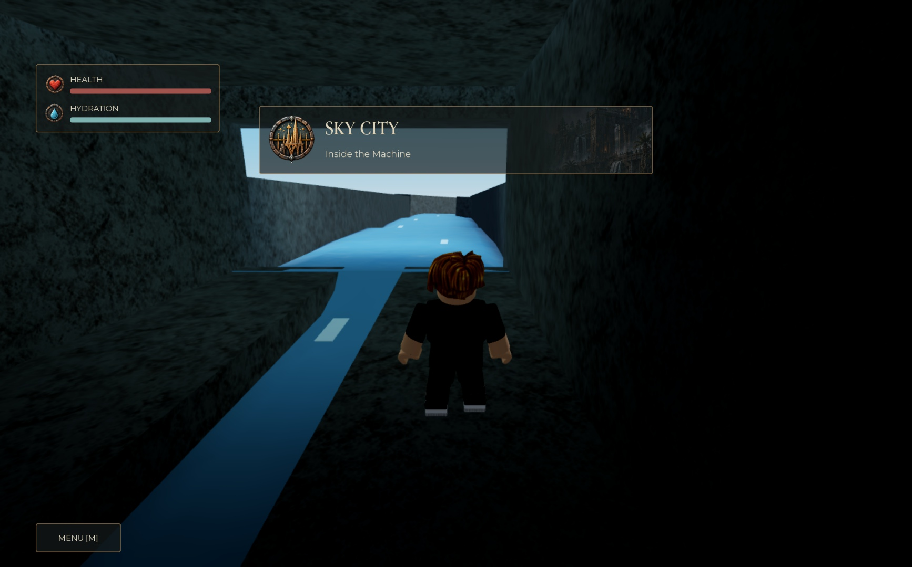
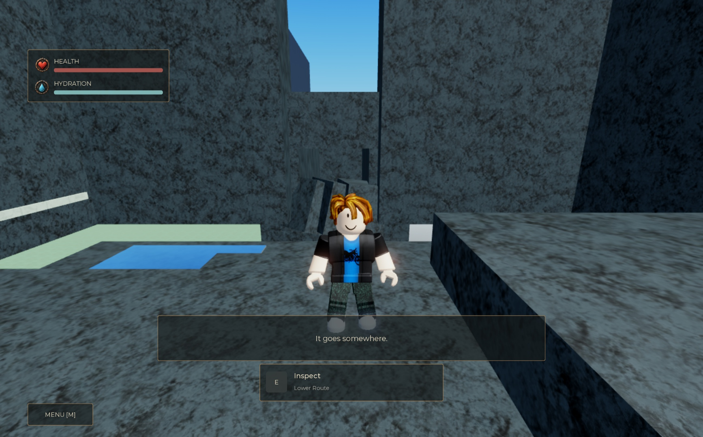

# World of Tethys — Roblox engineering

A Luau code portfolio for **Wildbound**, a prehistoric exploration and survival game set around a powerful river, human waterworks, and buried history. The current Studio prototype connects the Ordovic opening to an intake choice and a cave where Cordge responds to what the player observes.

**Status:** active prototype. This repository contains selected systems and tests from the working Studio place; it is not a complete, independently runnable game export. Finished character art, full-route acceptance and production persistence remain in progress.

## Start with the code

| System | Engineering problem | Read first |
| --- | --- | --- |
| Nature Scatter v1 | Repeatable environment placement that can be safely regenerated and cleared | [NatureScatter](src/ReplicatedStorage/Tethys/WorldModules/Scatter/NatureScatter.luau), [asset placement](src/ReplicatedStorage/Tethys/WorldModules/Scatter/AssetPlacement.luau), [Studio tests](tests/NatureScatter.spec.luau) |
| Tethys Terrain 0.1 | Seeded terrain authoring with a read-only preview, bounded edits and sculpt-safe cleanup | [heightfield](plugins/TethysTerrain/Modules/Heightfield.luau), [edit policy](plugins/TethysTerrain/Modules/EditSession.luau), [plugin guide](docs/engineering/tethys-terrain.md) |
| Ordovic opening | Apply downstream force while preserving lateral steering; hold and release a deliberate intake choice | [FlowMath](src/ServerScriptService/OrdovicOpening/FlowMath.luau), [IntakeService](src/ServerScriptService/OrdovicOpening/IntakeService.luau), [Controller](src/ServerScriptService/OrdovicOpening/Controller.luau) |
| Cordge observations | Reject invalid inspections and control one-shot dialogue, priority and per-player state | [CordgeController](src/ServerScriptService/OrdovicOpening/CordgeController.luau), [policy](src/ServerScriptService/OrdovicOpening/CordgePolicy.luau), [policy tests](tests/CordgePolicy.spec.luau) |
| Contextual HUD | Keep gameplay authoritative while presenting prompts, bounded notices and accessible transitions | [runtime binder](src/StarterPlayer/StarterPlayerScripts/WildboundUIRuntimeBinder.luau), [NoticeController](src/ReplicatedStorage/WildboundUI/Controllers/NoticeController.luau), [effects tests](tests/UIRuntime.effects.playtest.luau) |

The module layout follows Roblox services. Stateful services use small object instances; math, configuration and presentation policy remain separate. Existing owner integrations are provided as `.integration.txt` recipes, not substitutes for complete scripts.

## Inspectable behavior

- Scatter uses a stable asset ordering, seed `20261005`, category slope limits, scaled footprints and pass metadata. Replacement preserves the old pass on failure; Clear requires matching ownership. Spacing is within a pass, so interactions with other passes still need visual review.
- Native intake holds reach existing server handlers. Movement is restored on release, and unfinished rejection has its own session respawn destination.
- Cordge checks distance, walls, life, target ownership and duplicates. Observations support sparse authored speech without introducing quest rewards.
- HUD1.3 keeps Game1 quiet, preserves server title captions, gives speech/prompts priority and supports reduced motion. Location cards use a 0.65-second fade in, 1.5-second hold and 0.85-second fade out. Approved 3D portraits have a static menu adapter; no finished models are bundled.

## Validation

| Scope | Recorded result | Limit |
| --- | --- | --- |
| Latest HUD pass | 40 automated Studio groups; nine changed sources matched and compiled; native settings and title handoff passed | Title handoff used an assisted touch of an existing legacy trigger; new civic placement remains pending |
| Scatter v1 | 14 Studio test groups; seeded Terrain placement and Clear/Undo checked | Cross-pass exclusion and clustering are deferred |
| Opening/Cordge | 23 unit groups, 11 live Cordge groups, two subtitle ownership checks | Assisted checks do not establish a complete unassisted route |
| Water readability | Eight live groups; 102 cues sampled actual Terrain water | A route prototype, not a watershed simulation |
| Portable CI | Reuses the six Cordge policy cases; compiles all Luau sources/tests/tools; checks repository contents and links | Engine, Terrain, prompts and UI rendering require Studio |
| Terrain plugin 0.1 | 15 portable groups and nine native Terrain groups; model source round-trip | Dock interaction and plugin-owned Undo/Redo await local installation; see the plugin guide |

These are separate dated checkpoints, not one combined test total. See [testing and evidence](docs/engineering/testing.md), [recorded validation](docs/engineering/validation.json), and [setup](docs/engineering/setup.md).

*Controlled UI preview over the Ordovic graybox. It demonstrates artwork and layout; the real Wake does not award or display Sky City discovery.*

*Studio prototype: a native inspection prompt and sparse authored speech at the blocked cave route. Proxy art remains visible.*

## Development

[Architecture](docs/engineering/architecture.md) · [Setup](docs/engineering/setup.md) · [Roadmap](docs/engineering/roadmap.md) · [Mac terrain pipeline](docs/engineering/art-pipeline.md)

World direction, design decisions and asset selection: **Daniel Barletta**. Implementation and review developed with Codex assistance. The code and validation limits are available for inspection; this baseline imports the existing prototype rather than inventing a historical commit timeline.

Public material is limited to code, tests, engineering documentation and selected screenshots. Private design PDFs, place backups and original asset packs remain outside version control. No open-source license has been selected; publishing this portfolio does not grant an asset or source redistribution license. Nature Scatter is a candidate for a separately licensed tool later.
