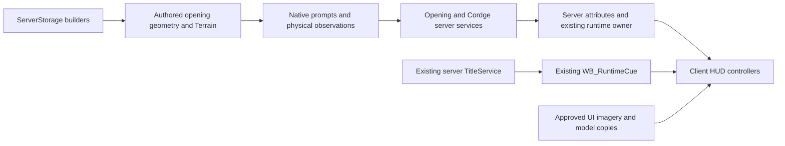

# Architecture and ownership

The prototype extends an existing Roblox place. This export includes the new opening, cave/Cordge services, Scatter and HUD; older RuntimeService, inventory/knowledge owners and the authored StarterGui/world hierarchy are external dependencies. Integration recipes make the narrow owner changes reviewable.

The regional-world handoff adds a planned multi-Place layer around those owners. A 2026-10-09 read-only Studio audit confirmed separate legacy knowledge owners and a disabled SaveService; [regional integration notes](regional-world-sprint.md) describe the reconciliation work. Regional travel and durable cross-Place progression are not implemented by the current export.

## Server decisions, client presentation

IntakeService owns capture/release and validates state and distance before a choice. CordgeController validates the actor, clue target, proximity, line of sight, life and duplicate observations. CordgePolicy owns independent player dialogue state; it can be tested without Roblox APIs. Opening checkpoints are session-only. UI reflects attributes and existing remote cues; it does not grant outcomes or discoveries.

This is consistent with Roblox's [client-server runtime](https://create.roblox.com/docs/projects/client-server) and [client-server boundary guidance](https://create.roblox.com/docs/scripting/security/client-server-boundary). Native prompts also need server validation; their visual presence is not authorization.

## World edits and ownership

Builders and runtime stay separate. Ordovic geometry carries Generator/BuildId; water writes have declared boxes and original voxel backups. Scatter uses stable source IDs, a designated Generated subtree and Generator/Seed/Biome/Category/PassId metadata. Clear and regeneration operate only on owned passes. Undo recording belongs to Studio edit tooling, not runtime players.

The engine capability sets are coarse, not per-path allowlists. The reviewed code supplies the path boundaries, and prior approved grants must not be broadened silently. Capability setup tools are maintenance artifacts, not scripts to run at startup or unreviewed instructions for a new production place.

## Presentation budget

Game1 keeps health, hydration, real injury state, native prompts, brief item receipts and authored speech. Exploration is restored by existing city/onboarding state. An authored TITLE can briefly appear while Game1 remains quiet. Menus, speech and native prompts suppress cards; queues and duplicate windows bound notice bursts. Reduced motion removes presentation tweens.

Technical region visits and dramatic reveals are separate. The title should appear at the first inhabited civic view, not Wake, Recovery or capture. Current legacy title triggers have not been relocated into the new route.

Saved HUD templates carry layout and art without example gameplay state.
[HUD1.4 preparation](ui-template-cleanup.md) keeps the ScreenGui disabled until
its real controllers bind, preventing sample quest/item text in Edit or loading.

## Deliberate limits

There is no custom replication layer or new DataStore backend in this export. Existing attribute replication and owner events meet the tested slice. Add network protocols when a real interaction requires them, with explicit payload validation and failure behavior. Add persistence with schema/versioning, concurrent-session protection and tested failures before describing it as production-ready.
