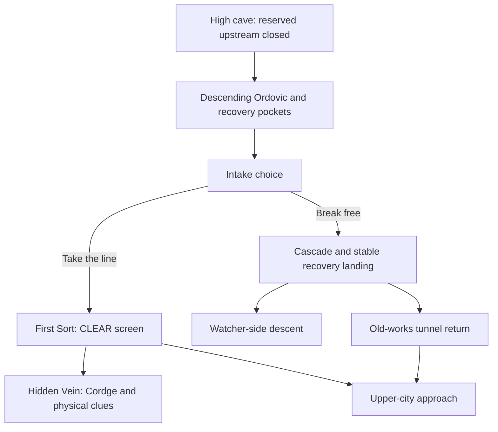

# Raised opening and regional routes

Installed on 2026-10-10 in Wildbound (`72645647440721`) around the creator's raised river references, First Sort
and upper-city floor. Direct user authorization replaced the earlier layout
hold. The exact commit was approved and completed. Native Studio Undo restored the
old opening and maintenance walk; Redo restored the raised layout. Capability
sets remain unchanged.

The active `Workspace.WildboundOpening_Ordovic` contains 1,159 descendants
after route polish. The original opening and voxel backups remain archived.
Its source is the current `Ordovic_River3.Ord_River_3` position plus four studs,
at approximately `(1285.4, 2473, -2838.2)`. It does not use old original-position
attributes or the mountain Model pivot as a safe spawn.

The main water spine is approximately 5,384.6 studs long. The dry city path is
1,352.9 studs; the Watcher descent is 3,272.6 studs; the tunnel return is 1,216.5
studs. These lengths do not establish measured playtime. Walking slabs are 18
studs wide with a maximum allowed grade of 0.36; tunnel roof interiors are
approximately 16 studs above their centerline floor. Live controller checks and their limits are recorded below. Terrain still
needs to surround and support these route grayboxes.

The installed river descends continuously instead of climbing into the moved
intake. The raised Cordge actor, bounds, observation prompts and blocked deeper
passage move together. The entrance's closed upstream stays reserved. Cleared
lower tiers are not regenerated or used as new terrain slabs.

## Runtime integration

[RouteProgressService](../../src/ServerScriptService/OrdovicOpening/RouteProgressService.luau)
samples physical dry arrivals. The separate
[RaisedRouteAdapter](../../src/ServerScriptService/WildboundServer/Services/RaisedRouteAdapter.luau)
validates each fixed marker through the existing Wildbound RuntimeService and
TitleService. It does not introduce another knowledge, save or respawn owner.
Earned route checkpoints are revalidated against actual dry, stable geometry
by the existing opening controller, after the existing Rest return gets priority.

[MaintenanceService](../../src/ServerScriptService/OrdovicOpening/MaintenanceService.luau)
requires a living character, a server-timed hold, range and line of sight.
Leaving, dying or releasing early cancels. CLEAR hides the actual ordinary
screen debris once and changes the authored bypass-current speed. This is a
graybox response, not hydraulic simulation; it grants no formal knowledge or
Home. Native keyboard holds verified early cancellation and one completion. The
five bypass speeds changed from 17 to 12; debris hid and the prompt disabled.

Arrival changes the contextual HUD through a server-authored chapter field;
the quiet opening and client preview override remain supported. Region titles
use the existing one-shot notice system and imagery. The public client skips
the Studio runtime-debug panel. Entering the Watcher approach does not award
Game 3 completion or bypass Game 2 learning.

## Live commit and collision corrections

[Commit driver](../../tools/ordovic/commit_raised_routes.luau) fills only 123
regions proven empty in both solid and liquid channels. It archives the old
opening and its Terrain backups in `ServerStorage.OrdovicLayoutHistory_20261010`,
disables that archived spawn, activates the staged root at
`Workspace.WildboundOpening_Ordovic`, and raises the existing First Sort
maintenance walk by 127.66 studs without changing its authored rotation.
The native old Terrain areas are currently empty; the driver does not restore
or write to them. Originals remain archived rather than deleted.

The connector recording must be available before commit. A failure reports
`UndoRequired`; it is not described as automatically rolled back. The complete
commit passed native menu Undo/Redo, including hierarchy and walk transforms. The reviewed builder and runtime
capability sets are unchanged.

## Verification and remaining release work

Live tests found and corrected a tunnel wall across the city entrance, a slope
starting inside the recovery landing, a return tunnel crossing the irreversible
drop face, a shared-landing tunnel wall across the Watcher walk, and a main bank
trapping the refusal handoff. Tunnel walls now stop before turns and shared
mouths. The Watcher route starts flat, the return goes around the drop, and only
the final owned bank is shortened to open the bypass. Native Terrain was not
rewritten for these corrections.

The city controller walk passed 24 supported targets in 85.2 seconds without
jumps or teleportation along the path. Its starting relocation was assisted.
The actual marker committed `CITY`, chapter 2 and the existing one-shot title
“Sky City — Inside the Machine.” A live death returned to that earned marker.
The stale legacy “Start at Ordovic Source” hint is suppressed after chapter
arrival; four isolated presentation checks passed.

All 123 new volumes contained native liquid at their centers. Eight water-cue
engine groups passed against 151 cues, including missing-water suppression.
Native keyboard holds exercised both intake choices and their real handlers.
After the bypass-mouth correction, guided camera turns and native swim input
traversed all five refusal drops to the dry landing; the existing controller
marked the cascade complete and applied the injury state. This started with an
assisted relocation to the intake; it is not a full unassisted river run.

The avatar walked the actual intake-to-cave connector, entry, wet-area steps
and overlook stairs. All five clues were inspected with native E input. Entry,
masonry, salt, blocked-route and overlook reactions were observed; formal
knowledge stayed unchanged. The reserved upstream and deeper rubble remain
closed. [Cave evidence](../media/raised-cordge-cave.jpg) shows the native prompt
and brief blocked-route subtitle after the raise.

Watcher descent passed 55 supported targets in 208.8 seconds, starting from
the recovery landing reached by the guided refusal swim. The return tunnel
passed 23 targets in 76.3 seconds after an assisted relocation to that landing.
Neither walk jumped or teleported between targets. Watcher arrival showed
“Watcher Volcano — The mountain ahead,” stayed in chapter 2, and returned to
its ridge checkpoint after death. Twelve structural groups passed; native rays
checked all 99 walking segments and their turns.
The reproducible controller probe uses a Server geometry snapshot from
[route_walk_targets](../../tools/ordovic/route_walk_targets.luau): a Client
GetChildren snapshot omits distant streamed Parts and cannot prove the route.

A complete unassisted main river run, physical Xbox/touch input, camera review
throughout the whole route, multi-client/streaming profiling and new-player
orientation remain acceptance work. Full Games 2–3 maintenance, characters,
first shelter, community/weather and wetland learning remain wider chapter
work. Session-only progression is not production persistence. These routes
are ready for continued authoring and guided playtesting, not release signoff.

GitHub publication remains blocked by the expired CLI login. No Roblox public
release has been made. Mac UI inspection became unavailable during the final
polish. The final polish still passed a native Undo/Redo round trip through
three owned edit waypoints using the documented
[ChangeHistoryService API](https://create.roblox.com/docs/reference/engine/classes/ChangeHistoryService).
The prior route hierarchy restored, then Redo restored its archive links,
current markers and opened bank. The save API refused Edit-context saving;
cloud saving remains unconfirmed and requires the Studio Save action. No
capabilities or game settings were changed to work around that refusal. See the
[dated evidence](raised-routes-validation.json).

The final portable CI pass checked 166 tracked files, compiled 126 Luau files,
and passed the separate 6 Cordge, 21 death-experience, 15 Terrain and 22 Stratum
groups plus both plugin source round trips. Four changed Studio sources matched
the repository. Two existing lower-tier water-audio warnings remain. The
streamed-Arrival error in the console came from the discarded client-only test
probe, not a shipped gameplay script.
