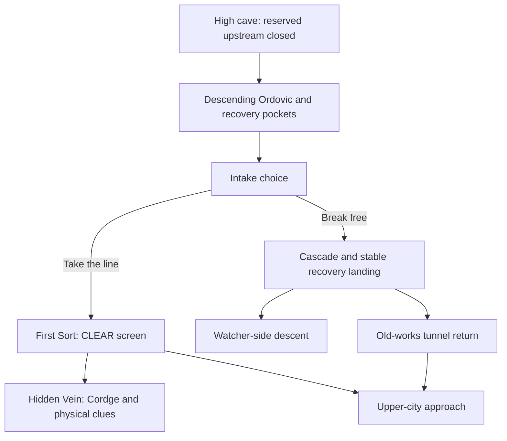

# Raised opening and regional routes

Prepared on 2026-10-10 around the creator's raised river references, First Sort
and upper-city floor. Direct user authorization replaced the earlier layout
hold. The live replacement is awaiting the exact commit approval required by
automatic approval review. The current opening has not been replaced.

The separate `ServerStorage.OrdovicRaisedStage` contains 1,145 descendants.
Its source is the current `Ordovic_River3.Ord_River_3` position plus four studs,
at approximately `(1285.4, 2473, -2838.2)`. It does not use old original-position
attributes or the mountain Model pivot as a safe spawn.

The main water spine is approximately 5,384.6 studs long. The dry city path is
1,352.9 studs; the Watcher descent is 3,271.5 studs; the tunnel return is 1,088.7
studs. These lengths do not establish measured playtime. Walking slabs are 18
studs wide with a maximum allowed grade of 0.36; tunnel roof interiors are
approximately 16 studs above their centerline floor. Native camera, junction
and avatar traversal still need a Play check after the commit.

The prepared river descends continuously instead of climbing into the moved
intake. The staged Cordge actor, bounds, observation prompts and blocked deeper
passage move together. The entrance's closed upstream stays reserved. Cleared
lower tiers are not regenerated or used as new terrain slabs.

## Runtime integration

[RouteProgressService](../../src/ServerScriptService/OrdovicOpening/RouteProgressService.luau)
samples physical dry arrivals. The separate
[RaisedRouteAdapter](../../src/ServerScriptService/WildboundServer/Services/RaisedRouteAdapter.luau)
validates each fixed marker through the existing Wildbound RuntimeService and
TitleService. It does not introduce another knowledge, save or respawn owner.
Earned route checkpoints are revalidated against actual dry, stable geometry
by the existing opening controller, after the existing Rest return gets priority.

[MaintenanceService](../../src/ServerScriptService/OrdovicOpening/MaintenanceService.luau)
requires a living character, a server-timed hold, range and line of sight.
Leaving, dying or releasing early cancels. CLEAR hides the actual ordinary
screen debris once and changes the authored bypass-current speed. This is a
graybox response, not hydraulic simulation; it grants no formal knowledge or
Home. Native input and cancellation remain live acceptance checks.

Arrival changes the contextual HUD through a server-authored chapter field;
the quiet opening and client preview override remain supported. Region titles
use the existing one-shot notice system and imagery. The public client skips
the Studio runtime-debug panel. Entering the Watcher approach does not award
Game 3 completion or bypass Game 2 learning.

## Exact pending live commit

[Commit driver](../../tools/ordovic/commit_raised_routes.luau) fills only 123
regions proven empty in both solid and liquid channels. It archives the old
opening and its Terrain backups in `ServerStorage.OrdovicLayoutHistory_20261010`,
disables that archived spawn, activates the staged root at
`Workspace.WildboundOpening_Ordovic`, and raises the existing First Sort
maintenance walk by 127.66 studs without changing its authored rotation.
The native old Terrain areas are currently empty; the driver does not restore
or write to them. Originals remain archived rather than deleted.

The connector recording must be available before commit. A failure reports
`UndoRequired`; it is not described as automatically rolled back. Live complete
commit Undo/Redo has not yet been exercised. The reviewed builder and runtime
capability sets are unchanged.

## Verification and remaining release work

[Ten structural checks](../../tests/RaisedRoutes.studio.luau) passed against the
separate stage. The prepared dry paths pass a world-geometry overlap preflight;
14 initial blocked slabs were rerouted around the crown mass and city structures.
All 123 Terrain targets pass the read-only solid/liquid preflight. The test's
hold-duration comparison uses tolerance for Roblox float storage.

These are staging results, not a playable release. Required live checks include
cave exit, swimming/current continuity, both intake branches, dry-path junctions,
native CLEAR completion/cancellation, Cordge inspections, restrained titles,
checkpoint death/reset and complete Undo/Redo. Full Games 2-3 maintenance,
characters, first shelter, community/weather and wetland learning remain wider
chapter work. Session-only progression is not production persistence.

GitHub publication remains blocked by the expired CLI login. Roblox publishing
controls are available in Studio, but the staged replacement and its live tests
must finish first. No public release has been made by this pass. See the
[dated staging evidence](raised-routes-validation.json).
