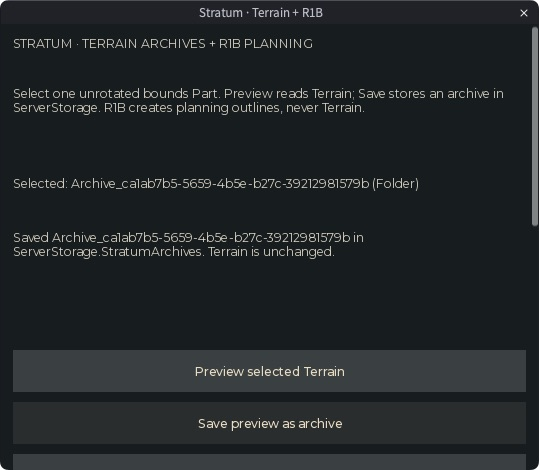
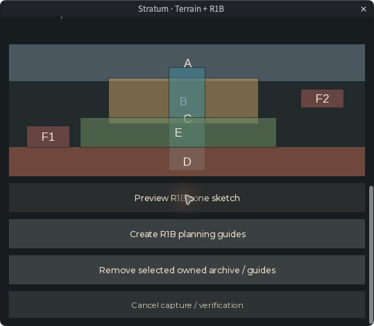

# Stratum 0.1: Terrain archives and R1B planning

Stratum is a local Studio authoring plugin with a bounded voxel archive format and an authored Sky City/Cimmeria planning sketch. It accompanies [Tethys Terrain](tethys-terrain.md), which generates small native Terrain patches. This milestone follows the selected priority: **Studio terrain tools + R1B planning**.

The supplied design document mixes environment direction, proposed runtime code and showcase copy. This implementation keeps the useful landform plan and rebuilds the archive foundation against native API behavior. It does not implement a multiplayer streaming framework or support the supplied frame-rate, bandwidth, zero-GC or license claims.

## Use and local installation

```sh
python3 tools/package_terrain_plugin.py --plugin Stratum
```

This creates `output/stratum-plugin/Stratum.rbxmx`: one Script with eleven separate child ModuleScripts. Generated models are excluded from Git. Insert it in an expendable place and use **Plugins -> Save as Local Plugin** on the top-level Script. The entry requires the Studio `plugin` context; it is not a gameplay Script. [Roblox plugin instructions](https://create.roblox.com/docs/studio/plugins).

The confirmed Wildbound development place has a disabled source copy at `ServerStorage.StratumPlugin`, with `Modules` and `Tests.EngineFixture`. The approved local installation is named `StratumLocalInstall.rbxmx`. Installation includes the entry and eleven modules; the engine fixture is not distributed in that plugin model.

Open **Plugins -> Tethys -> Stratum**. Its panel scrolls, so it can fit alongside Explorer/Properties. Studio may restore a small dock or floating window; enlarge it to review the controls and preview.

1. Select one unrotated bounds Part in Explorer. Stratum reads its bounds, rounds the edges outward to the 4-stud voxel grid, and preserves the Part.
2. **Preview selected Terrain** reads native solid material, solid occupancy and liquid occupancy. The status gives voxel/chunk counts, encoded binary bytes, stored Base64 bytes and capture time.
3. **Save preview as archive** rereads every source chunk and rejects a changed snapshot. It then acquires a native Undo recording and stores an owned archive in ServerStorage.
4. **Validate selected archive** verifies its identity, manifest, grid, payload lengths, checksums and summary.
5. For R1B, select a regional bounds Part and **Preview R1B zone sketch**. Inspect the provisional orientation and zone layout before **Create R1B planning guides**. Creation rechecks the selected bounds and requires an Undo recording.
6. **Remove selected owned archive / guides** accepts only one valid direct child of a Stratum-owned root. It refuses unrelated selections and unowned descendants inside a guide pass. Native Undo owns the removal.

Capture yields and checks Cancel between bounded chunks. Save lets queued cancellation/edit input run before its final bounded serial recheck, then performs that recheck without yielding between chunks. This avoids missing an edit to an already checked chunk. Cancel invalidates the current preview; it cannot interrupt a native read or the final serial scan. Save/guide creation/removal refuse Play mode. They also refuse to change the scene if Studio declines their recording.

The plugin never writes Terrain. The reconstruction writer exists only in the isolated engine test. There is no terrain-restore UI in this version.

## Bounds and storage

Archive selections have a maximum of **262,144 voxels**, **64 chunks**, and **1,024 studs per dimension**. All bounds align to the 4-stud grid. Chunks split at global 128-stud boundaries, including negative coordinates and cropped edges. Each chunk is at most 32 voxels per axis. Archive limits differ from regional R1B guide limits.

```text
ServerStorage
  StratumPlugin [disabled source Script]
    Modules [11 ModuleScripts]
    Tests
      EngineFixture [ModuleScript]
  StratumArchives [Generator=StratumArchive]
    Archive_<guid> [Folder]
      V_<minVoxelX>_<minVoxelY>_<minVoxelZ> [StringValue, one per chunk]

Workspace
  Generated
    StratumR1B [Generator=StratumR1B]
      Plan_<guid> [Folder]
        A_Backbone ... F2_Hazard [7 Parts, each with an Outline SelectionBox]
        Route_<routeId>_<index> [15 Parts, each with an Outline SelectionBox]
```

Archives carry `Generator`, `Version`, `ArchiveId`, `Format`, `Resolution`, `BoundsMin`, `BoundsSize`, `ChunkCount`, `VoxelCount`, `EncodedBytes` and `StoredTextBytes`. Each chunk stores bounds attributes and a canonical Base64 `StringValue.Value`. Buffers cannot be stored directly in an Instance attribute; ASCII storage also avoids arbitrary binary-string encoding concerns. Base64 increases stored bytes. [Instance attributes](https://create.roblox.com/docs/reference/engine/classes/Instance#SetAttribute), [buffer API](https://create.roblox.com/docs/reference/engine/libraries/buffer).

R1B passes carry `Generator`, `Version`, `PassId`, `PlanningOnly`, `Orientation`, `BoundsMin` and `BoundsSize`. Parts also carry purpose/ownership and, where relevant, height bands or `Reserved`. They are anchored, transparent, noncolliding, nontouchable and nonqueryable. SelectionBoxes provide visible outlines. Ownership metadata prevents accidental tool cleanup; it is not an authenticated security boundary.

Only matching roots are reused. A root with unrelated ownership blocks the operation. Existing manual structures and original assets are outside the cleanup path. Removal detaches the original folder rather than destroying it: native Undo retains its hierarchy and reference links. Archive validation must pass before removal, so a corrupt archive must be reviewed/deleted manually rather than silently discarded by the tool.

## STV1 format

Cells are flattened in X/Y/Z order, with Z varying fastest. Each dense cell uses an actual **u16 material ID + f32 solid occupancy + f32 liquid occupancy**, ten bytes. Occupancy must be finite and in `[0, 1]`. Floating-point encoding has explicit f32 precision; the native fixture verifies reconstruction against the engine's actual quantized channels. Material values are not one-byte enumeration indexes.

| Header offset | Bytes | Field |
| --- | --- | --- |
| 0 | 4 | `STV1` magic |
| 4 | 1 | Version 1 |
| 5 | 1 | Mode: 0 dense, 1 run-length encoding |
| 6, 7, 8 | 1 each | X/Y/Z voxel dimensions |
| 9, 10 | 1 + 2 | Reserved zeros |
| 12 | 4 | Cell count |
| 16 | 4 | Payload byte count |
| 20 | 4 | Adler-32 payload checksum |

An RLE record is a u16 run length followed by one ten-byte cell. Encoding selects RLE only when it is smaller than dense storage. Decode rejects unsupported versions, appended/truncated buffers, nonzero reserved fields, invalid counts/occupancy, corrupt checksums and runs that exceed or fail to cover the declared volume. Limits are checked before output arrays are allocated. The checksum detects accidental corruption, not malicious forgery.

A 32-cube of one repeated cell encodes to 36 bytes; a diverse 32-cube falls back to 327,704 bytes including the header. These are deterministic format tests, not representative world-compression or network benchmarks. Native expansion checks actual `Enum.Material` values and rejects unknown IDs or Water used as the solid-material channel. Water occupancy remains independent. [Terrain voxel channels](https://create.roblox.com/docs/reference/engine/classes/Terrain).

## Modules

| Module | Responsibility |
| --- | --- |
| [VoxelCodec](../../plugins/Stratum/Modules/VoxelCodec.luau) | Bounded STV1 dense/RLE encoding and validation |
| [Base64](../../plugins/Stratum/Modules/Base64.luau) | Canonical bounded ASCII archive storage |
| [ChunkGrid](../../plugins/Stratum/Modules/ChunkGrid.luau) | Global-grid bounds, edge slicing and deterministic keys |
| [VoxelMatrix](../../plugins/Stratum/Modules/VoxelMatrix.luau) | Native enum/channel conversion |
| [Capture](../../plugins/Stratum/Modules/Capture.luau) | Complete manifest validation and byte accounting |
| [Session](../../plugins/Stratum/Modules/Session.luau) | Busy/cancel lifecycle, read-only preview and stale-source verification |
| [ArchiveStorage](../../plugins/Stratum/Modules/ArchiveStorage.luau) | Unparented archive preparation and native archive reading |
| [R1BPlan](../../plugins/Stratum/Modules/R1BPlan.luau) | Authored zones, height bands and provisional route markers |
| [R1BGuides](../../plugins/Stratum/Modules/R1BGuides.luau) | Unparented planning geometry and owned-pass validation |
| [RobloxBackend](../../plugins/Stratum/Modules/RobloxBackend.luau) | Selected bounds, native Terrain reads and recorded instance edits |
| [Panel](../../plugins/Stratum/Modules/Panel.luau) | Dock controls, status and read-only zone preview |

Production transactions use [ChangeHistoryService](https://create.roblox.com/docs/reference/engine/classes/ChangeHistoryService). Prepared instances remain unparented until recording begins. Failure cancels the recording before rolling back owned objects. The plugin cancels its pending recording on unload and releases UI connections; it never resets global history or changes project capabilities.

## R1B environment direction

R1B bounds are **128-2,048 studs wide/deep**, **64-2,048 tall**. Native Parts silently clamp at 2,048 studs; this limit preserves the planned geometry. Larger planning regions need an explicit tiled design later.

| Zone | Build intent |
| --- | --- |
| A | Broad inland Cimmerian backbone; highest continuous mountain mass |
| B | Authored folded city cradle and shelves |
| C | Weep water corridor: gather inland, broaden beside work, constrict/spill seaward |
| D | Exposed Watcher-facing cliff/ledge |
| E | Lower working slopes for waterworks, hatchery and workshops |
| F1/F2 | Two localized hazard pockets; preserve broad mountain silhouettes |

Five three-marker route sketches cover a sheltered city route, exposed ledge, waterworks, hidden ruin and a reserved future upland route. The final route's markers carry `Reserved=true`; they create no traversal, trigger or access unlock.

**Inland -Z / seaward +Z is provisional**, not a survey of existing Wildbound geography. These guides are a starting sketch for site-specific authoring. Review orientation, water direction, city footprint and landform scale before use. Build macro landforms, shelves/cuts and readable routes before ruins or districts. This tool does not replace the existing Sky City or solve a watershed.

The Ordovic opening still guides through visible water surfaces. Its inaccessible upstream and blocked deeper cave remain reserved; the leaf lesson belongs to later Sky City. See the [tool suite roadmap](tool-suite-roadmap.md) for the next terrain milestone.

## Evidence and acceptance

The dated [validation record](stratum-validation.json) separates **22 portable groups**, **12 native fixture groups**, packaging/source checks and **12 assisted installed-plugin checks**. Native save and guide creation Undo/Redo passed. Removal Undo restored all 22 guide Parts/outlines and both archive payloads exactly; Redo detached them again. All generated test passes and archives were removed, both Terrain boxes are empty again, and the source archive remains disabled. Empty owned archive/guide roots remain ready for manual use.

The status now retains successful operation messages while a separate label follows selection. Installed testing also verified refusal for manual content, unrelated selections, moved bounds and canceled previews. The initial removal implementation used Destroy, which broke Undo; these results apply to the corrected detach implementation. This is assisted acceptance of the named controls, not a full usability or large-world performance study.



*A small empty-Terrain archive saved through the actual plugin. This uniform dataset demonstrates the control flow, not representative compression.*



*The provisional authored sketch shown in the installed panel. Colored rectangles are planning zones, not generated landforms.*

Reproduction commands:

```sh
.tooling/luau-0.741/luau tests/Stratum.spec.luau
python3 tools/ci_checks.py --luau-dir .tooling/luau-0.741
```

For native tests, place [Stratum.studio.luau](../../tests/Stratum.studio.luau) in a fixture ModuleScript and invoke its returned function with the plugin's Modules folder in Edit mode. It requires two initially empty 32-stud boxes at the coordinates stated in the fixture. It restores the native channels, selection and owned fixtures after checks. Terrain writes in that test are distinct from the read-only production plugin.

The native test exposed a read/write detail: `ReadVoxelChannels` returns a `Size` field that `WriteVoxelChannels` rejects. The fixture now projects only the three valid channel keys. The two initially empty test boxes from that first attempt were explicitly restored and verified before the successful rerun.

No runtime dispatch, RemoteFunction, Actor pool, chunk eviction, anti-scraping guarantee, hydraulic erosion, import/conversion of legacy scripts, or public release is included. Wildbound's native instance streaming remains the runtime baseline. [Native streaming](https://create.roblox.com/docs/workspace/streaming). `--!strict` annotations and successful syntax compilation do not establish full Roblox type analysis. No source/asset redistribution license has been selected.
